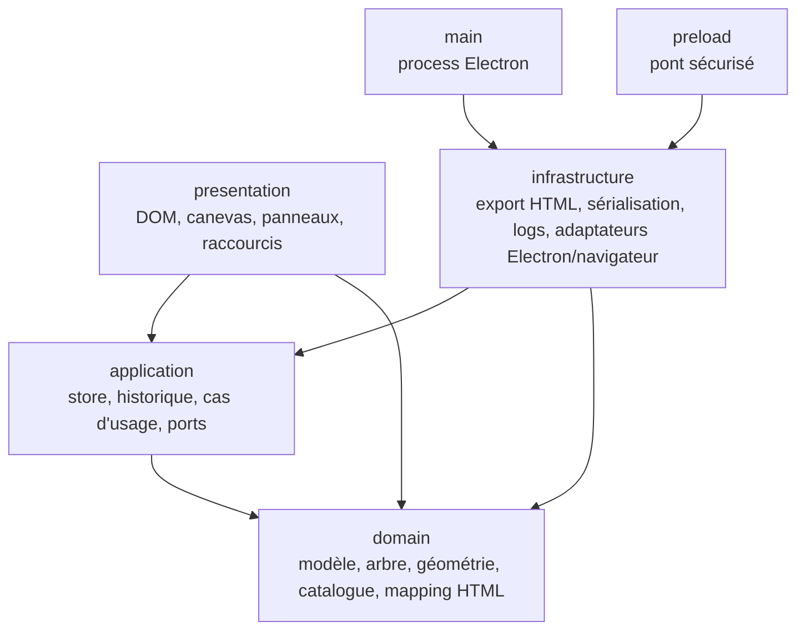

# Architecture

UI Designer est une application Electron écrite en TypeScript, organisée en **couches**. Chaque couche
ne dépend que des couches situées en dessous d'elle ; les détails techniques (Electron, système de
fichiers, DOM) restent aux bords.

| Dossier | Rôle | Peut importer |
| --- | --- | --- |
| `src/domain` | Modèle immuable du document, opérations sur l'arbre, géométrie, catalogue des types d'éléments, correspondance élément → HTML/CSS. Aucune dépendance. | rien |
| `src/application` | État de l'éditeur (`EditorStore`), annuler/rétablir (`History`), transformations (déplacer, redimensionner, aligner, grouper), cas d'usage fichiers (`ProjectService`), **ports** (interfaces `Logger`, `FileGateway`, `DocumentSerializer`…). | domain |
| `src/infrastructure` | Implémentations des ports : export HTML, format `.uidesign`, logger et puits de logs (console, fichier, IPC), adaptateurs renderer (Electron / navigateur), contrat IPC. | domain, application |
| `src/presentation` | Interface du renderer : canevas, interactions souris, panneaux, vues Aperçu/Code, commandes et raccourcis. `index.ts` est la racine de composition du renderer. | toutes |
| `src/main` | Process principal Electron : fenêtre, menu natif, dialogues, protocole d'aperçu, logs fichier. Racine de composition côté Node. | infrastructure, application (types) |
| `src/preload` | Expose `window.uiDesigner` (API typée `DesktopApi`) au renderer isolé. | infrastructure (contrat) |

## Flux d'une action

1. Un geste (souris, raccourci, menu natif, panneau) appelle une **méthode du store** ou une
   **commande** du registre (`presentation/commands.ts`). Le menu natif n'envoie qu'un identifiant de
   commande ; les raccourcis sont gérés dans le renderer pour que les champs texte gardent leurs
   raccourcis natifs.
2. Le store calcule un **nouveau document** avec les fonctions pures du domaine / de
   `application/transform.ts`, empile l'état précédent dans l'historique, puis notifie les abonnés
   avec un `ChangeSet` (document / sélection / interface).
3. Les vues se mettent à jour : le canevas reconstruit uniquement les nœuds DOM des éléments
   modifiés (le document étant immuable, un sous-arbre inchangé garde la même référence), les
   panneaux rafraîchissent leurs champs sans écraser celui en cours de saisie.

Les gestes continus (déplacer, redimensionner) passent par `beginGesture / updateGesture /
endGesture` : chaque étape est recalculée à partir du document de départ (pas d'accumulation
d'erreurs) et le geste complet produit **une seule** entrée d'historique. Les saisies successives
dans un même champ sont fusionnées (clé de fusion, fenêtre d'une seconde).

## Modèle

- Un `UiDocument` contient le canevas (taille, fond, transparence), la grille et une liste
  d'`UiElement`.
- Un élément a un type (catalogue dans `domain/catalog.ts`), un nom (devient l'`id` HTML), une
  position `x/y` **relative à la boîte intérieure de son parent** (à l'intérieur de la bordure), une
  taille, un style commun, des propriétés propres au type et des enfants (boîtes uniquement).
- Les coordonnées absolues (`absoluteRect`) servent à l'affichage, au test de clic et à
  l'aimantation ; le reparentage conserve la position à l'écran.

## Rendu identique à l'export

`domain/html.ts` produit pour chaque élément une spécification (`tag`, attributs, déclarations CSS,
contenu). Le canevas en construit des nœuds DOM avec des styles en ligne ; l'exporteur en écrit du
HTML avec une règle CSS par élément. Les deux partagent aussi `BASE_CSS`. Ce que l'on dessine est
donc exactement ce qui est exporté.

## Sécurité Electron

- `contextIsolation`, `sandbox`, pas de `nodeIntegration` ; le renderer ne voit que `DesktopApi`.
- CSP stricte sur la page de l'éditeur (`script-src 'self'`).
- L'aperçu tourne dans une iframe `sandbox="allow-scripts"` chargée depuis le protocole privé
  `uidpreview://` servi par le process principal : les scripts « au clic » de l'utilisateur
  s'exécutent sans accès à l'application, et ne sont jamais exécutés dans le canevas.
- Navigation et ouverture de fenêtres bloquées ; liens http(s) ouverts dans le navigateur système.

## Choix techniques

- **Electron** : le résultat est du HTML, autant le rendre avec un vrai moteur de navigateur
  (Chromium) ; l'application fonctionne entièrement hors ligne.
- **TypeScript sans framework d'interface** : peu de dépendances, rendu ciblé maîtrisé.
- **esbuild** pour regrouper les trois points d'entrée, **Vitest** pour les tests,
  **electron-builder** pour l'installeur Windows.
- **Historique par instantanés** : le document immuable partage les sous-arbres inchangés, stocker
  des instantanés est peu coûteux et beaucoup plus simple que des commandes inverses.
